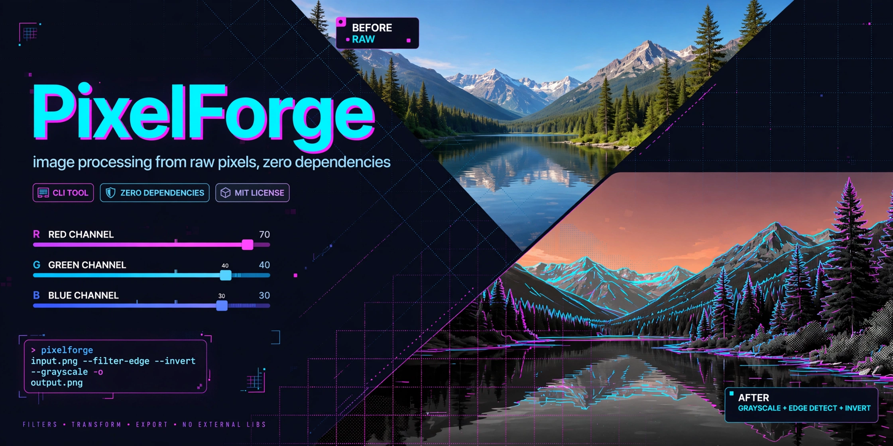

# PixelForge



An **image-processing CLI built from raw pixels in C++17 with zero external
libraries** — the BMP and PPM parsers, every filter, and the geometric transforms
are all implemented from first principles. No OpenCV, no stb, no libpng.

## Features

- **Hand-rolled codecs** — uncompressed 24-bit BMP (headers, row padding,
  bottom-up rows, BGR→RGB) and binary PPM (P6, comments, arbitrary whitespace).
- **Pixel operations** — `grayscale` (Rec. 601 luminance), `invert`,
  `brightness`, `contrast`, `box blur`, `Sobel edge detection`.
- **Geometric transforms** — bilinear `resize`, 90° clockwise `rotate`.
- **CLI with subcommands** — format auto-detected from the file extension
  (`.bmp` / `.ppm`).

## Build

```bash
cmake -S . -B build -DCMAKE_BUILD_TYPE=Release
cmake --build build
```

This produces `build/pixelforge` and `build/pixelforge_tests`.
Built with `-Wall -Wextra`; the build is warning-free.

## Run

```bash
./build/pixelforge <op> [op-args] -i INPUT -o OUTPUT

# examples
./build/pixelforge gray -i photo.bmp -o gray.ppm
./build/pixelforge sobel -i photo.bmp -o edges.bmp
./build/pixelforge bright 30 -i photo.ppm -o brighter.ppm
./build/pixelforge contrast 1.5 -i photo.bmp -o punchy.bmp
./build/pixelforge blur 2 -i photo.bmp -o soft.bmp
./build/pixelforge resize 800 600 -i photo.bmp -o small.ppm
./build/pixelforge rot90 -i photo.bmp -o rotated.bmp
./build/pixelforge invert -i photo.ppm -o negative.ppm
```

## Tests

```bash
cmake --build build && ./build/pixelforge_tests
# or: ctest --test-dir build
```

A self-contained test runner (no external framework) checks every operation on
small synthetic images against hand-computed expected values: exact grayscale
luminance values, invert round-trips, brightness clamping, contrast identity at
factor 1.0, box-blur window math on a center dot, Sobel silence on flat images
and response on a step edge, resize corner preservation, rotate90 pixel mapping,
plus BMP round-trip, BMP bottom-up row order, garbage-input rejection, PPM
round-trip, and PPM comment parsing. **16 test cases, 51 assertions — all passing.**

## CLI reference

```
pixelforge <op> [op-args] -i INPUT -o OUTPUT

  gray                  grayscale (luminance)
  invert                invert colors
  bright <amount>       brightness, e.g. bright 30 / bright -20
  contrast <factor>     contrast, e.g. contrast 1.5
  blur <radius>         box blur, e.g. blur 2
  sobel                 Sobel edge detection
  resize <w> <h>        bilinear resize, e.g. resize 800 600
  rot90                 rotate 90 degrees clockwise
```

Formats are detected from the file extension (`.bmp`, `.ppm`).

## Layout

```
src/
  image.hpp            in-memory RGB image type
  bmp.{hpp,cpp}        hand-rolled 24-bit BMP codec
  ppm.{hpp,cpp}        hand-rolled binary PPM (P6) codec
  ops.{hpp,cpp}        filters + transforms
  cli_main.cpp         subcommand CLI
tests/
  test_main.cpp        self-contained test runner
```

## Tech stack

C++17 · CMake · raw pixel buffers · zero external dependencies.

## License

MIT — see [LICENSE](LICENSE).
